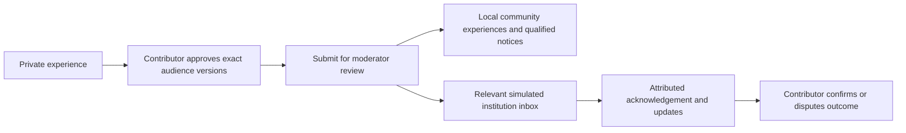

# South African Digital Confidence Lab

**People’s digital-safety experiences, shared by choice and connected to a visible response.**

This participant-originated project explores how ordinary South Africans could describe scams or attempted fraud, help others recognise similar experiences, and reach relevant organisations. An organisation may be impersonated or able to help without being responsible.

Built with Codex during the **Andela × OpenAI Codex Accelerator — Cape Town Cohort 2026**. This is independent participant work; no organiser, bank or institutional endorsement is implied.

**Working local proof of concept. Fictional data and simulated institutions only.** Institution tagging is manual; incident matching uses explainable rules. There is **no runtime AI, paid API, model download or commercial key requirement**. This is not a public reporting, emergency-assistance or money-recovery service.

## The connected journey



Implemented capabilities:

- Four-step reporting; private original, separately approved community and organisation text.
- Multiple institutions and relationships, including impersonation, service involvement and potential assistance.
- Moderator approval, withholding and clarification requests with reasons and attribution.
- Explained related/duplicate candidates, human decisions and qualified community notices.
- Persistent immediate notification simulation, institution-specific permissions and duplicate prevention.
- Institutional updates and contributor follow-up; corrections and withdrawal stop further sharing while retaining accurate history.
- Server-side access checks, durable SQLite storage, responsive layouts and keyboard controls.

## African storytelling fit

The contribution is helping people communicate their own experiences to audiences who may learn or respond—not simply collecting tickets.

| Brief track | What the prototype demonstrates |
| --- | --- |
| Voices & Languages | Preserves original text in all 11 written official languages and mixed-language answers. English UI; SASL media and translation are not implemented. |
| Discovery & Audience | Contributor-chosen community/institutional audiences and reviewed links between experiences. |
| Creation & Craft | A person writes once, edits audience-specific copies and approves the exact words shared. |
| Truth, Authorship & Ownership | Versioned approvals, attribution, uncertainty labels, corrections and disputes; a report is never treated as verified fact. |

This is the project's interpretation of the supplied brief, not a claim of organiser approval. Research into banking confidence remains independently valuable; see [project context](docs/project-context.md).

## Run locally

Prerequisites: **Node.js 22.23.4**, npm (verified with **12.2.2**) and a modern browser. No account registration or API key. From the repository root, in PowerShell:

```powershell
cd prototype
npm.cmd ci --ignore-scripts
$env:NEXT_TELEMETRY_DISABLED = '1'
npm.cmd run setup
npm.cmd run build
npm.cmd start
```

Open [http://127.0.0.1:3000](http://127.0.0.1:3000). In a second terminal, from `prototype/`:

```powershell
Get-Content .demo/account-keys.local.txt
```

Select the corresponding account in the app and paste its generated demo key. **Keep this file private; never include it in screenshots or Git.**

| Account | Demonstration role |
| --- | --- |
| `contributor-a`, `contributor-b` | Separate private reports and sharing choices |
| `moderator` | Review submissions, relationships and notices |
| `institution-bank` | Fictional Example Bank inbox and responses |
| `institution-mobile` | Fictional Example Mobile inbox and responses |

Community viewing is available after sign-in. Example Payments is selectable but has no seeded representative. Setup creates accounts, not prefilled reports, and refuses to overwrite existing data. **On later runs, skip setup and run `npm.cmd start`** (rebuild only after source changes). Stop with Ctrl+C. For development, use `npm.cmd run dev`. Do not expose the server through a public host or tunnel.

Follow the [3–5 minute demonstration](docs/demo-walkthrough.md) for exact fictional text, preparation and role changes. See the [prototype guide](prototype/README.md) for storage and workflow details.

## Verification and Codex contributions

From `prototype/`:

```powershell
npm.cmd test
npm.cmd run typecheck
npm.cmd run build
```

Final verification is recorded in [verification results](docs/final-verification.md), including clean setup and browser checks. The separate survey has 69 offline mocked tests; from the repository root run `npm.cmd --prefix survey test`. Those tests need no clasp installation and do not contact Google.

Codex assisted planning, public-source research synthesis, implementation, debugging, security/permission tests, browser verification and documentation. The participant originated the concept, approved scope/design decisions, tested the roles and chose to omit runtime AI. [Development evidence](docs/codex-development-log.md) distinguishes actual actions and results from proposals.

## Limits and future work

- No real institutional participation, external notifications, production identity verification or public deployment.
- No established fraud reduction, user demand, multilingual comprehension or campaign-detection accuracy.
- Copying text is not redaction or anonymity. All selected institutions receive the same approved organisation prose with their own relationship context.
- Delivered snapshots are retained after withdrawal. Local data is unencrypted; the developer can access demo keys. SQLite is experimental on this Node version; CSP retains development allowances.
- Daily/weekly digests, SASL media, validated language support and institutional integrations are future work. **AI-assisted institution association is a potential future enhancement only**, requiring resources, privacy controls and evaluation. [Milestone 3 decision](docs/milestone-3-feasibility.md)
- The survey's unused clasp dependency has previously recorded unresolved audit findings; it is separate from the prototype and unnecessary for editor deployment or offline survey tests. See [survey documentation](survey/README.md).

## Repository map

| Directory | Contents |
| --- | --- |
| [prototype/](prototype/README.md) | Working application, locked dependencies and tests |
| [docs/](docs/project-context.md) | Context, decisions, evidence, demonstration and publication preparation |
| [research/](research/README.md) | Dated public-source assessments; no private interviews or respondent data |
| [survey/](survey/README.md) | Approved questionnaire, Apps Script generator and mocked tests |

[AGENTS.md](AGENTS.md) records development safeguards. No original brief/deck, private responses, local keys or databases are distributed. Publication remains subject to owner approval; see [GitHub preparation](docs/github-publication.md).

Submission deadline supplied by the participant: **midnight Wednesday, 11 November 2026, South African time**.
